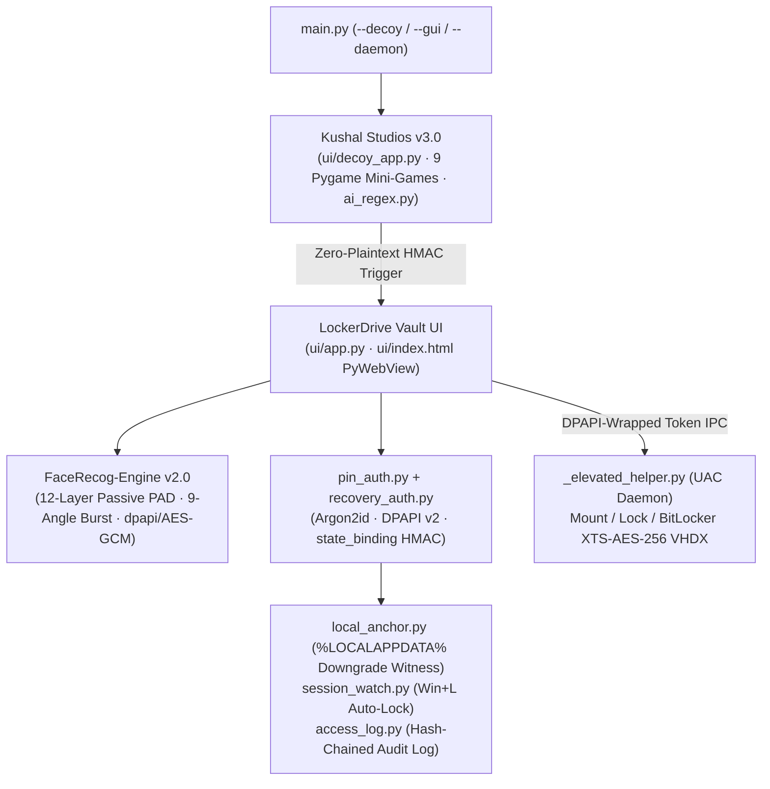

# 🔒 LockerDrive v11.0

> **Production-Grade Biometric BitLocker Vault & Decoy Arcade Suite**  
> Windows 11 macOS Sequoia-inspired HIG WebView interface (`PyWebView`), 9-Angle 360° TrueDepth Face ID (`FaceRecog-Engine v2.0`), 12-layer passive anti-spoofing (`CHROM rPPG` + `MiDaS 3D Depth` + `MiniFASNetV2`), Argon2id + Windows DPAPI + HMAC-SHA256 state binding, Upfront Zero-Prompt UAC Daemon, and the **Kushal Studios v3.0** Decoy Arcade Hub.

[](LICENSE.md)
[](#quick-start--commands)
[](#architecture-overview)

---

## Executive Overview & Value Proposition

**LockerDrive** is a dual-persona, zero-knowledge desktop security IP asset pairing a functional **9-game Pastel Arcade & Offline AI Chat Decoy (`Kushal Studios v3.0`)** with a cryptographically hardened **Windows BitLocker VHDX Vault**. Entering the zero-plaintext HMAC-committed trigger phrase into the decoy AI chat transitions cleanly into the biometric vault over an upfront-authenticated UAC daemon — eliminating repeated UAC interruptions while defending against replay, cold-downgrade, virtual camera injection, and presentation attacks.

## Architecture Overview



See [`ARCHITECTURE.md`](ARCHITECTURE.md) for deep technical details across the cryptographic binding hierarchy and biometric PAD pipeline.

---

## Repository Structure

```text
LockerDrive/
├── main.py                              # Unified entrypoint (--gui, --decoy, --enroll-face, --start-daemon)
├── Kushal Studios.bat                   # Portable launcher for Decoy Hub (%LOCALAPPDATA% Python / PATH fallback)
├── Run_LockerDrive.bat                  # Portable launcher for LockerDrive Vault UI
├── launch_game.py                       # Windowless subprocess launcher for the 9 Pygame arcade titles
├── assets/                              # Application icons (.ico/.png) and synthesized game WAV SFX
├── engine/                              # Core Cryptographic, Biometric & Volume Subsystem
│   ├── config.py                        # Multi-drive, storage & env-overridable configuration
│   ├── local_anchor.py                  # Vault-scoped C:\ HMAC downgrade witness & model pinning
│   ├── state_binding.py                 # Argon2id-derived purpose-separated HMAC-SHA256 bindings
│   ├── vault_secret.py                  # Windows DPAPI wrapper for BitLocker volume secret
│   ├── pin_auth.py                      # Argon2id PIN hashing, v2 DPAPI envelope & escalating lockout
│   ├── recovery_auth.py                 # 96-bit emergency recovery key subsystem
│   ├── face_auth.py                     # 9-Angle 360° burst enrollment & centroid verification
│   ├── vault_mount.py                   # DPAPI-authenticated IPC bridge for Upfront UAC Daemon
│   ├── _elevated_helper.py              # Persistent Administrator daemon (VHDX mount, unlock, lock, resize)
│   ├── access_log.py                    # Hash-chained + keyed-MAC tamper-evident audit log
│   ├── session_watch.py                 # Win32 WTS session-lock watcher (instant lock on Win+L)
│   └── ai_regex.py                      # Offline regex AI engine with HMAC-committed vault triggers
├── ui/                                  # PyWebView UI bridge, Apple HIG HTML frontend, Decoy Arcade & games
├── FaceRecog-Engine/                    # Standalone v2.0 12-Layer Passive Liveness & 3D Biometric SDK
├── docs/                                # Threat modeling, red-team audits & cryptographic research
├── setup/                               # Provisioning & non-destructive verification suites (222 checks)
├── .env.example                         # Environment template (LOCKERDRIVE_DRIVE_ROOT, MOUNT_LETTER, etc.)
├── ARCHITECTURE.md                      # System & cryptographic design specification
├── LICENSE.md                           # Proprietary Commercial Evaluation License + Third-Party Carve-Out
├── PRIVACY.md                           # Zero-cloud & biometric compliance statement
└── TERMS.md                             # Commercial evaluation terms
```

---

## Quick Start & Commands

1. **Install Dependencies & Configure Environment:**
   ```powershell
   copy .env.example .env
   pip install -r requirements.txt
   powershell -ExecutionPolicy Bypass -File setup\install_face.ps1
   ```

2. **Launch Kushal Studios (Decoy Arcade + AI Chat):**
   * Double-click **`Kushal Studios.bat`** (approves UAC once upfront; enter your configured HMAC trigger in Studio AI to unlock).

3. **Launch LockerDrive Vault Directly:**
   * Double-click **`Run_LockerDrive.bat`**.

4. **Run Non-Destructive Security & Biometric Test Suite (Isolated Temp Sandbox):**
   ```powershell
   python setup\run_all_tests.py
   ```

---

## License & Commercial Inquiries

Copyright (c) 2026 Kushal (`@onlykushalll`). All Rights Reserved.  
This repository is a proprietary software asset available for commercial licensing, technical due diligence, or full IP acquisition. See [`LICENSE.md`](LICENSE.md) for the **Third-Party Upstream Carve-Out** covering upstream Python ML/vision packages (`PyTorch`, `ONNX Runtime`, `InsightFace`, `MediaPipe`, `OpenCV`, `cryptography`) and Windows OS APIs.

- **Commercial & M&A Contact:** `creatormanager27@gmail.com`
- **Privacy Policy:** [`PRIVACY.md`](PRIVACY.md) · **Terms:** [`TERMS.md`](TERMS.md)
